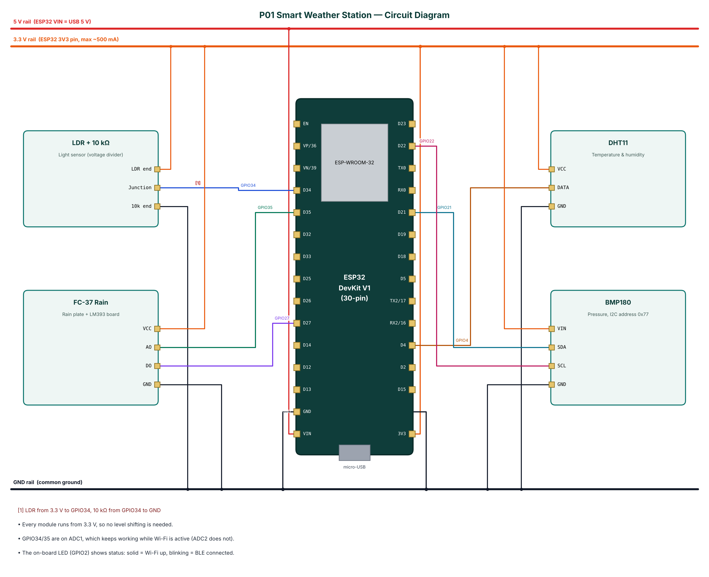

# P01 — Smart Weather Station with Rain Forecast

**Cloud:** ThingSpeak · **Level:** Intermediate · **Approx. cost:** ₹770 (incl. ESP32, breadboard, cable)

This project builds a low-cost, connected weather station around the ESP32 microcontroller. A DHT11 sensor measures air temperature and relative humidity, a BMP180 barometer measures atmospheric pressure, a light-dependent resistor (LDR) measures ambient light and an FC-37 rain plate detects rainfall. The ESP32 derives heat index and dew point, keeps a three-hour history of pressure and turns the pressure trend into a short-term forecast, using rules similar to the classical Zambretti forecaster. Readings are uploaded every 20 seconds over Wi-Fi to ThingSpeak, a free MATLAB-backed IoT cloud that stores the data and draws charts. At the same time the station acts as a Bluetooth Low Energy (BLE) peripheral, so a phone can show live values, change settings and configure Wi-Fi without any internet connection. The complete bill of materials costs well under ₹1,000.

📄 Full report: [`reports/P01_Smart_Weather_Station/P01_Smart_Weather_Station_Report.pdf`](../reports/P01_Smart_Weather_Station/P01_Smart_Weather_Station_Report.pdf) (also `.docx`) — circuit diagram, DFD level 0/1, flowchart, setup steps, test cases, source listing.

## Wiring

| Module | Pin | ESP32 | Note |
|---|---|---|---|
| LDR + 10 kΩ | LDR end | 3V3 |  |
| LDR + 10 kΩ | Junction | GPIO34 | LDR from 3.3 V to GPIO34, 10 kΩ from GPIO34 to GND |
| LDR + 10 kΩ | 10k end | GND |  |
| FC-37 Rain | VCC | 3V3 |  |
| FC-37 Rain | AO | GPIO35 |  |
| FC-37 Rain | DO | GPIO27 |  |
| FC-37 Rain | GND | GND |  |
| DHT11 | VCC | 3V3 |  |
| DHT11 | DATA | GPIO4 |  |
| DHT11 | GND | GND |  |
| BMP180 | VIN | 3V3 |  |
| BMP180 | SDA | GPIO21 |  |
| BMP180 | SCL | GPIO22 |  |
| BMP180 | GND | GND |  |



## Build & flash

* Arduino IDE: board **ESP32 Dev Module**, Partition Scheme **Minimal SPIFFS (1.9MB APP with OTA)**.
* Libraries: NimBLE-Arduino 2.x, ArduinoJson 7.x, PubSubClient, DHT sensor library (Adafruit), Adafruit Unified Sensor, Adafruit BMP085 Library.
* Or download `firmware-P01_Smart_Weather_Station` from GitHub **Actions** and flash `*.merged.bin` at `0x0` with https://espressif.github.io/esptool-js/.

## Configure over BLE

Open **https://rohitkukreja705.github.io/esp32-iot-projects/?p=P01** in Chrome (Android/desktop) → Connect → `IOT-P01-XXXX` → Setup → PIN `1234` → Wi-Fi → cloud keys.

| Setting | Default | Meaning |
|---|---|---|
| `tskey` | — | ThingSpeak Write API Key |
| `tsint` | 20 | Upload interval in seconds (≥ 15) |
| `rainthr` | 30 | Rain threshold in % wetness |

| Command | PIN | Action |
|---|---|---|
| `read` | No | Read the sensors now and send a data frame |
| `upload` | No | Upload to ThingSpeak as soon as the 15 s limit allows |

Example frame:

```json
{"t":29.4,"h":62,"p":1004.6,"l":71,"rn":0,"hi":31.9,"dp":21.4,"fc":"Fair, stable","wifi":true,"type":"data"}
```

## ThingSpeak objects

| Object | Content |
|---|---|
| Field 1 | Temperature (°C) |
| Field 2 | Humidity (%) |
| Field 3 | Pressure (hPa) |
| Field 4 | Light (%) |
| Field 5 | Rain (%) |
| Field 6 | Heat index (°C) |
| Field 7 | Dew point (°C) |
| Field 8 | Wi-Fi RSSI (dBm) |
| Status | Forecast text |

## Safety

* Keep the ESP32 and DHT11 inside a ventilated, rain-proof enclosure; expose only the rain plate.
* Power the rain plate only when reading it (or use a capacitive sensor) to slow corrosion.
