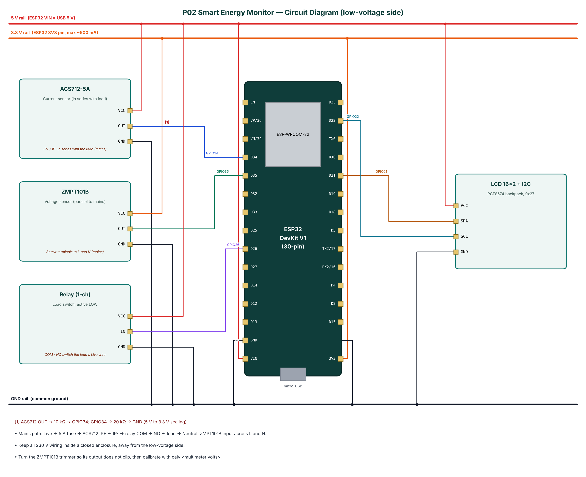

# P02 — Smart Energy Monitor with Overload Protection

**Cloud:** Adafruit IO · **Level:** Advanced · **Approx. cost:** ₹1205 (incl. ESP32, breadboard, cable)

This project measures the electrical consumption of a single AC appliance and protects it from overload. A ZMPT101B transformer module senses the 230 V mains voltage and an ACS712-5A Hall-effect module senses the load current. The ESP32 samples both channels together at 10 kHz for ten mains cycles and computes true RMS voltage, true RMS current, real power, apparent power and power factor, then integrates real power into kilowatt-hours and an estimated electricity cost in rupees. A 16x2 LCD shows the values locally and a relay can disconnect the load. The relay trips automatically when power stays above a set limit. Data is published to Adafruit IO over MQTT, where a dashboard shows gauges and charts and a toggle switches the load remotely. Over BLE the same data, relay control and a two-point calibration routine are available on a phone.

📄 Full report: [`reports/P02_Smart_Energy_Monitor/P02_Smart_Energy_Monitor_Report.pdf`](../reports/P02_Smart_Energy_Monitor/P02_Smart_Energy_Monitor_Report.pdf) (also `.docx`) — circuit diagram, DFD level 0/1, flowchart, setup steps, test cases, source listing.

## Wiring

| Module | Pin | ESP32 | Note |
|---|---|---|---|
| ACS712-5A | VCC | 5V (VIN) |  |
| ACS712-5A | OUT | GPIO34 | ACS712 OUT -> 10 kΩ -> GPIO34; GPIO34 -> 20 kΩ -> GND (5 V to 3.3 V scaling) |
| ACS712-5A | GND | GND |  |
| ZMPT101B | VCC | 3V3 |  |
| ZMPT101B | OUT | GPIO35 |  |
| ZMPT101B | GND | GND |  |
| Relay (1-ch) | VCC | 5V (VIN) |  |
| Relay (1-ch) | IN | GPIO26 |  |
| Relay (1-ch) | GND | GND |  |
| LCD 16x2 + I2C | VCC | 5V (VIN) |  |
| LCD 16x2 + I2C | SDA | GPIO21 |  |
| LCD 16x2 + I2C | SCL | GPIO22 |  |
| LCD 16x2 + I2C | GND | GND |  |



## Build & flash

* Arduino IDE: board **ESP32 Dev Module**, Partition Scheme **Minimal SPIFFS (1.9MB APP with OTA)**.
* Libraries: NimBLE-Arduino 2.x, ArduinoJson 7.x, PubSubClient, LiquidCrystal I2C (Frank de Brabander / johnrickman).
* Or download `firmware-P02_Smart_Energy_Monitor` from GitHub **Actions** and flash `*.merged.bin` at `0x0` with https://espressif.github.io/esptool-js/.

## Configure over BLE

Open **https://rohitkukreja705.github.io/esp32-iot-projects/?p=P02** in Chrome (Android/desktop) → Connect → `IOT-P02-XXXX` → Setup → PIN `1234` → Wi-Fi → cloud keys.

| Setting | Default | Meaning |
|---|---|---|
| `aiouser / aiokey` | — | Adafruit IO username and key |
| `maxw` | 1000 | Overload trip limit (W) |
| `tariff` | 7 | Electricity tariff (₹/kWh) |
| `vcal / ical` | 0.70 / 0.00811 | Calibration factors (set by calv/cali) |

| Command | PIN | Action |
|---|---|---|
| `relay:on / relay:off` | Yes | Switch the load |
| `reset` | Yes | Reset kWh counter |
| `calv:<volts>` | Yes | Calibrate voltage against a multimeter reading |
| `cali:<amps>` | Yes | Calibrate current against a clamp-meter reading |

Example frame:

```json
{"v":231.4,"i":0.412,"w":88.6,"va":95.3,"pf":0.93,"kwh":1.274,"cost":8.92,"relay":true,"cloud":true,"type":"data"}
```

## Adafruit IO objects

| Object | Content |
|---|---|
| p02-voltage | Voltage (V) — line chart / gauge |
| p02-current | Current (A) — gauge |
| p02-power | Real power (W) — line chart |
| p02-energy | Energy (kWh) — text block |
| p02-relay | Toggle block, ON/OFF values — remote load switch |

## Safety

* 230 V AC can kill. Build only under supervision of a person experienced with mains wiring.
* Use a closed plastic enclosure, a 5 A fuse in the live line and proper screw terminals; no breadboard on the mains side.
* Never touch the board or sensors while the mains plug is connected; program and test the low-voltage side first.
* The ACS712-5A must not carry more than 5 A continuously; size the fuse accordingly.
