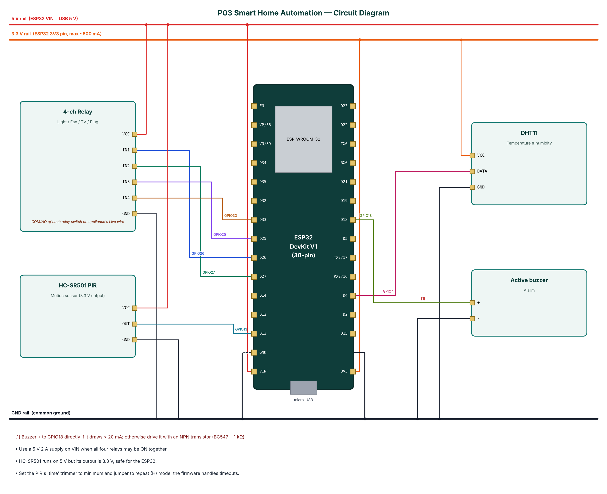

# P03 — Smart Home Automation with Away-Mode Security

**Cloud:** Adafruit IO · **Level:** Intermediate · **Approx. cost:** ₹1025 (incl. ESP32, breadboard, cable)

This project converts four ordinary electrical appliances into smart appliances that can be controlled from a phone over Bluetooth Low Energy or from anywhere in the world through the Adafruit IO cloud dashboard. A 4-channel relay module switches a light, a fan, a TV socket and a spare plug. A PIR motion sensor and a DHT11 temperature-humidity sensor enable automation: in AUTO mode the light turns on when someone enters and off after a period without motion, and the fan follows the room temperature with hysteresis. In AWAY mode the same motion sensor becomes an intruder detector that sounds a buzzer and publishes an alert. Relay states are saved in flash and restored after power cuts, and the cloud and BLE views are kept in sync.

📄 Full report: [`reports/P03_Smart_Home_Automation/P03_Smart_Home_Automation_Report.pdf`](../reports/P03_Smart_Home_Automation/P03_Smart_Home_Automation_Report.pdf) (also `.docx`) — circuit diagram, DFD level 0/1, flowchart, setup steps, test cases, source listing.

## Wiring

| Module | Pin | ESP32 | Note |
|---|---|---|---|
| 4-ch Relay | VCC | 5V (VIN) |  |
| 4-ch Relay | IN1 | GPIO26 |  |
| 4-ch Relay | IN2 | GPIO27 |  |
| 4-ch Relay | IN3 | GPIO25 |  |
| 4-ch Relay | IN4 | GPIO33 |  |
| 4-ch Relay | GND | GND |  |
| HC-SR501 PIR | VCC | 5V (VIN) |  |
| HC-SR501 PIR | OUT | GPIO13 |  |
| HC-SR501 PIR | GND | GND |  |
| DHT11 | VCC | 3V3 |  |
| DHT11 | DATA | GPIO4 |  |
| DHT11 | GND | GND |  |
| Active buzzer | + | GPIO18 | Buzzer + to GPIO18 directly if it draws < 20 mA; otherwise drive it with an NPN transistor (BC547 + 1 kΩ) |
| Active buzzer | - | GND |  |



## Build & flash

* Arduino IDE: board **ESP32 Dev Module**, Partition Scheme **Minimal SPIFFS (1.9MB APP with OTA)**.
* Libraries: NimBLE-Arduino 2.x, ArduinoJson 7.x, PubSubClient, DHT sensor library (Adafruit), Adafruit Unified Sensor.
* Or download `firmware-P03_Smart_Home_Automation` from GitHub **Actions** and flash `*.merged.bin` at `0x0` with https://espressif.github.io/esptool-js/.

## Configure over BLE

Open **https://rohitkukreja705.github.io/esp32-iot-projects/?p=P03** in Chrome (Android/desktop) → Connect → `IOT-P03-XXXX` → Setup → PIN `1234` → Wi-Fi → cloud keys.

| Setting | Default | Meaning |
|---|---|---|
| `aiouser / aiokey` | — | Adafruit IO credentials |
| `lightto` | 60 | Light-off timeout (s) |
| `fanon` | 30 | Fan-on temperature (°C) |

| Command | PIN | Action |
|---|---|---|
| `r1:on|off|toggle … r4:…` | Yes | Switch one appliance |
| `all:off / all:on` | Yes | Switch all four |
| `mode:auto|manual|away` | Yes | Change mode |
| `alarm:off` | Yes | Silence the alarm |

Example frame:

```json
{"t":30.1,"h":58,"m":true,"mode":"AUTO","alarm":false,"r":[1,1,0,0],"cloud":true,"type":"data"}
```

## Adafruit IO objects

| Object | Content |
|---|---|
| p03-light / p03-fan / p03-tv / p03-plug | Toggle blocks with ON/OFF values |
| p03-mode | Text or multi-button block: AUTO, MANUAL, AWAY |
| p03-temperature, p03-humidity | Gauge / line chart |
| p03-motion | Indicator or stream block (MOTION / CLEAR / INTRUSION) |

## Safety

* Appliance wiring is at 230 V AC: use proper screw terminals, insulation and an enclosure.
* Do not exceed the relay rating (10 A resistive; derate for motors).
* Keep the low-voltage ESP32 wiring physically separated from mains wiring.
