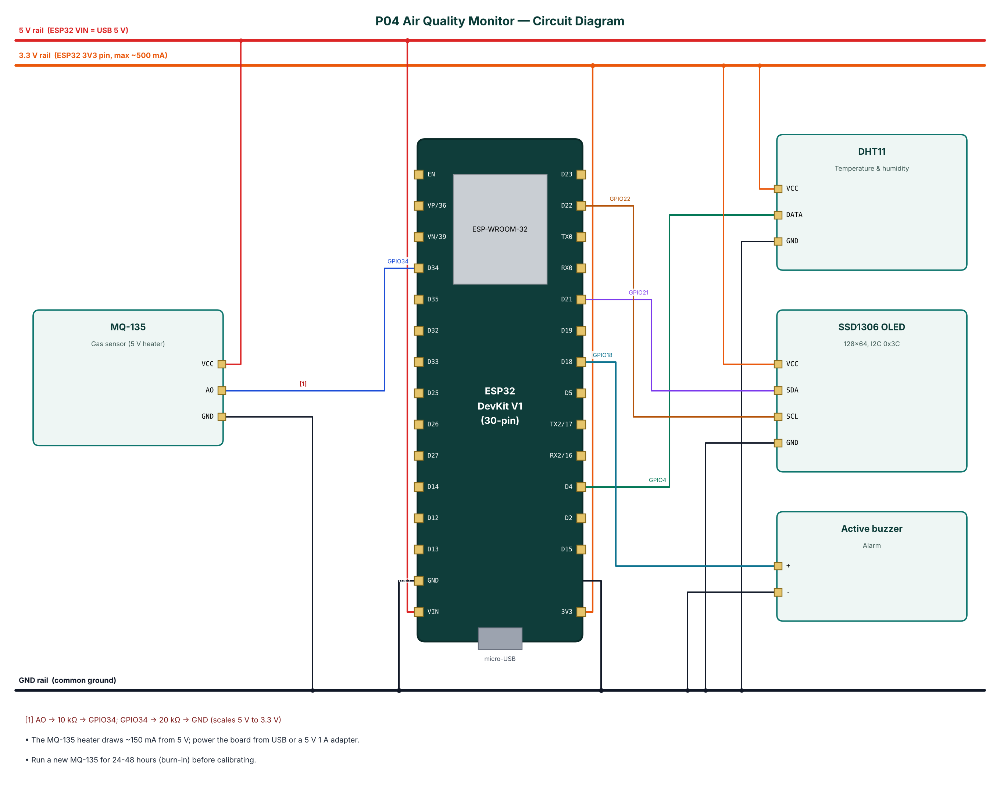

# P04 — Indoor Air Quality Monitor with Alarm

**Cloud:** ThingSpeak · **Level:** Intermediate · **Approx. cost:** ₹930 (incl. ESP32, breadboard, cable)

Indoor air in kitchens, classrooms, offices and bedrooms can contain high levels of carbon dioxide, smoke and volatile organic compounds. This project uses an MQ-135 metal-oxide gas sensor to estimate a CO₂-equivalent concentration, compensates the sensor reading for temperature and humidity measured by a DHT11, and classifies air quality into five levels from Good to Hazardous. Values are shown on an OLED display, streamed to a phone over Bluetooth Low Energy and logged to ThingSpeak for long-term trends. A buzzer warns when the concentration exceeds an adjustable limit and can be muted from the phone. A one-tap calibration in clean outdoor air stores the sensor's reference resistance in flash.

📄 Full report: [`reports/P04_Air_Quality_Monitor/P04_Air_Quality_Monitor_Report.pdf`](../reports/P04_Air_Quality_Monitor/P04_Air_Quality_Monitor_Report.pdf) (also `.docx`) — circuit diagram, DFD level 0/1, flowchart, setup steps, test cases, source listing.

## Wiring

| Module | Pin | ESP32 | Note |
|---|---|---|---|
| MQ-135 | VCC | 5V (VIN) |  |
| MQ-135 | AO | GPIO34 | AO -> 10 kΩ -> GPIO34; GPIO34 -> 20 kΩ -> GND (scales 5 V to 3.3 V) |
| MQ-135 | GND | GND |  |
| DHT11 | VCC | 3V3 |  |
| DHT11 | DATA | GPIO4 |  |
| DHT11 | GND | GND |  |
| SSD1306 OLED | VCC | 3V3 |  |
| SSD1306 OLED | SDA | GPIO21 |  |
| SSD1306 OLED | SCL | GPIO22 |  |
| SSD1306 OLED | GND | GND |  |
| Active buzzer | + | GPIO18 |  |
| Active buzzer | - | GND |  |



## Build & flash

* Arduino IDE: board **ESP32 Dev Module**, Partition Scheme **Minimal SPIFFS (1.9MB APP with OTA)**.
* Libraries: NimBLE-Arduino 2.x, ArduinoJson 7.x, PubSubClient, DHT sensor library (Adafruit), Adafruit Unified Sensor, Adafruit SSD1306, Adafruit GFX Library.
* Or download `firmware-P04_Air_Quality_Monitor` from GitHub **Actions** and flash `*.merged.bin` at `0x0` with https://espressif.github.io/esptool-js/.

## Configure over BLE

Open **https://rohitkukreja705.github.io/esp32-iot-projects/?p=P04** in Chrome (Android/desktop) → Connect → `IOT-P04-XXXX` → Setup → PIN `1234` → Wi-Fi → cloud keys.

| Setting | Default | Meaning |
|---|---|---|
| `tskey` | — | ThingSpeak Write API Key |
| `alarmppm` | 1500 | Alarm threshold (ppm) |
| `r0` | 10 | Reference resistance (set by calibrate) |

| Command | PIN | Action |
|---|---|---|
| `calibrate` | Yes | Set R0 in clean outdoor air |
| `mute` | No | Mute alarm for 10 minutes |

Example frame:

```json
{"ppm":684,"t":27.9,"h":55,"rs":38.12,"r0":52.4,"ratio":0.727,"lvl":2,"cat":"Moderate","alarm":false,"type":"data"}
```

## ThingSpeak objects

| Object | Content |
|---|---|
| Field 1 | CO₂-equivalent (ppm) |
| Field 2 | Temperature (°C) |
| Field 3 | Humidity (%) |
| Field 4 | Rs/R0 |
| Field 5 | Level (1-5) |
| Status | Level name |

## Safety

* The MQ-135 heater gets hot (~50 °C on the case); do not touch it during operation.
* Do not rely on this device for life-safety gas detection.
