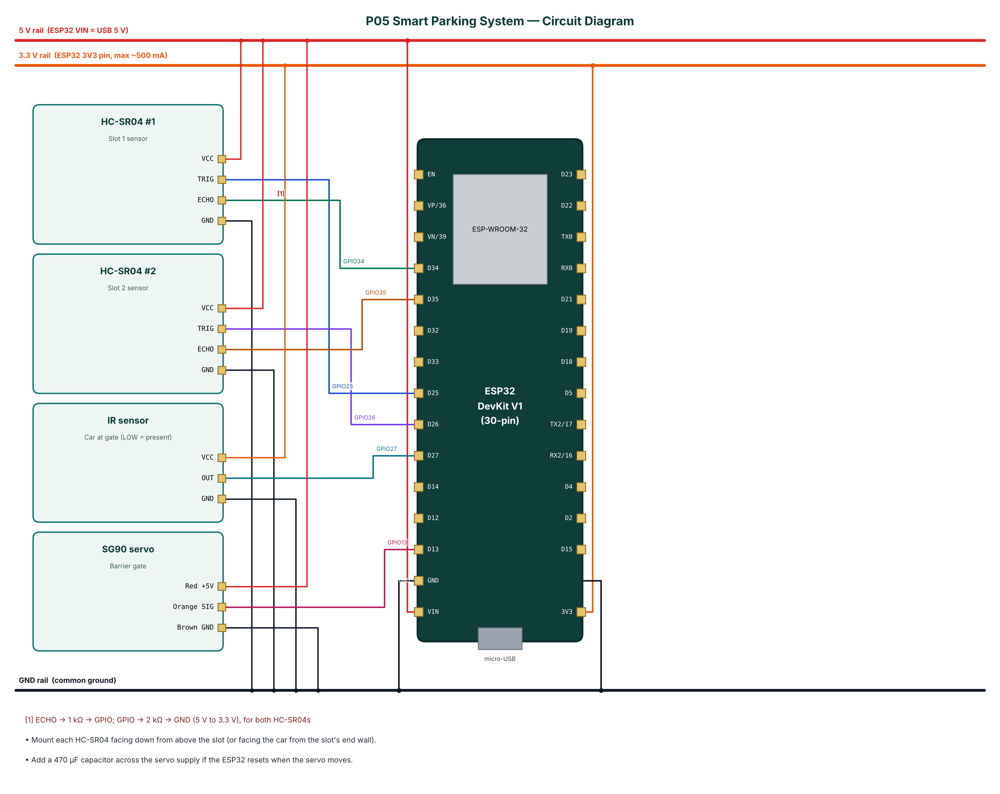

# P05 — Smart Parking System with Automatic Gate

**Cloud:** Supabase · **Level:** Intermediate · **Approx. cost:** ₹805 (incl. ESP32, breadboard, cable)

Finding a free parking slot wastes time and fuel and causes congestion at the entrance of malls, colleges and apartments. This project monitors each parking slot with an HC-SR04 ultrasonic sensor and controls an entry barrier with an SG90 servo. An IR sensor detects a car at the gate; the barrier opens only if a slot is free and closes automatically after the car has passed, otherwise a 'Parking FULL' event is raised. Slot status is debounced and written to a Supabase PostgreSQL database through its REST API, together with an event log, so any browser or app can show live availability. A phone connected over BLE shows a live slot map and lets the attendant open or close the gate manually.

📄 Full report: [`reports/P05_Smart_Parking_System/P05_Smart_Parking_System_Report.pdf`](../reports/P05_Smart_Parking_System/P05_Smart_Parking_System_Report.pdf) (also `.docx`) — circuit diagram, DFD level 0/1, flowchart, setup steps, test cases, source listing.

## Wiring

| Module | Pin | ESP32 | Note |
|---|---|---|---|
| HC-SR04 #1 | VCC | 5V (VIN) |  |
| HC-SR04 #1 | TRIG | GPIO25 |  |
| HC-SR04 #1 | ECHO | GPIO34 | ECHO -> 1 kΩ -> GPIO; GPIO -> 2 kΩ -> GND (5 V to 3.3 V), for both HC-SR04s |
| HC-SR04 #1 | GND | GND |  |
| HC-SR04 #2 | VCC | 5V (VIN) |  |
| HC-SR04 #2 | TRIG | GPIO26 |  |
| HC-SR04 #2 | ECHO | GPIO35 |  |
| HC-SR04 #2 | GND | GND |  |
| IR sensor | VCC | 3V3 |  |
| IR sensor | OUT | GPIO27 |  |
| IR sensor | GND | GND |  |
| SG90 servo | Red +5V | 5V (VIN) |  |
| SG90 servo | Orange SIG | GPIO13 |  |
| SG90 servo | Brown GND | GND |  |



## Build & flash

* Arduino IDE: board **ESP32 Dev Module**, Partition Scheme **Minimal SPIFFS (1.9MB APP with OTA)**.
* Libraries: NimBLE-Arduino 2.x, ArduinoJson 7.x, PubSubClient, ESP32Servo.
* Or download `firmware-P05_Smart_Parking_System` from GitHub **Actions** and flash `*.merged.bin` at `0x0` with https://espressif.github.io/esptool-js/.

## Configure over BLE

Open **https://rohitkukreja705.github.io/esp32-iot-projects/?p=P05** in Chrome (Android/desktop) → Connect → `IOT-P05-XXXX` → Setup → PIN `1234` → Wi-Fi → cloud keys.

| Setting | Default | Meaning |
|---|---|---|
| `sburl / sbkey` | — | Supabase project URL and publishable key |
| `occcm` | 10 | Occupied distance threshold (cm) |

| Command | PIN | Action |
|---|---|---|
| `gate:open / gate:close` | Yes | Manual barrier control |
| `sync` | No | Re-upload all slot states |

Example frame:

```json
{"s":[1,0],"d":[6,38],"free":1,"gate":"closed","car":false,"type":"data"}
```

## Supabase objects

| Object | Content |
|---|---|
| parking_slots | One row per slot: occupied, distance_cm, updated_at (PATCH) |
| parking_events | slot_occupied / slot_freed / full_rejected with free_slots (INSERT) |
| parking_summary (view) | free_slots, total_slots, last_change |

## Safety

* The servo barrier is a model; a real barrier needs safety sensors so it never closes on a vehicle or person.
* Power the servo from 5 V, not 3.3 V; its stall current can brown-out the ESP32.
