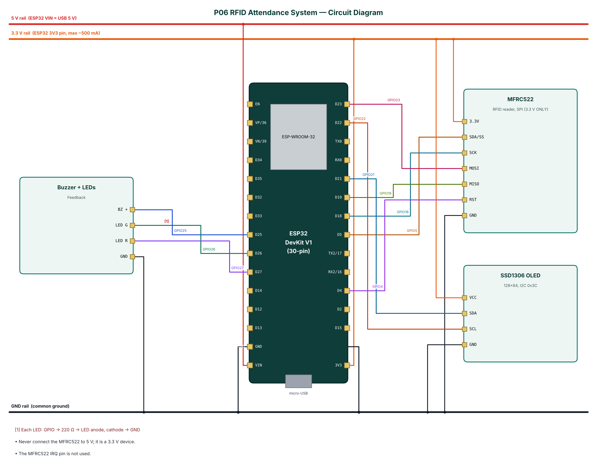

# P06 — RFID Attendance System with Offline Queue

**Cloud:** Supabase · **Level:** Advanced · **Approx. cost:** ₹935 (incl. ESP32, breadboard, cable)

Paper registers and roll-calls waste class and work time and are easy to falsify. This project records attendance with 13.56 MHz RFID cards read by an MFRC522 module. Each tap is matched against a member list, toggled between IN and OUT, confirmed with an OLED message, a beep and an LED, and stored in a Supabase PostgreSQL table with a timestamp. The member list is cached in the ESP32's flash so the reader keeps working without internet; offline scans are queued in a LittleFS file and uploaded automatically when Wi-Fi returns. An administrator enrols new cards from a phone over BLE by typing a name and tapping the card. A SQL view produces the day's first-in and last-out times per member.

📄 Full report: [`reports/P06_RFID_Attendance_System/P06_RFID_Attendance_System_Report.pdf`](../reports/P06_RFID_Attendance_System/P06_RFID_Attendance_System_Report.pdf) (also `.docx`) — circuit diagram, DFD level 0/1, flowchart, setup steps, test cases, source listing.

## Wiring

| Module | Pin | ESP32 | Note |
|---|---|---|---|
| MFRC522 | 3.3V | 3V3 |  |
| MFRC522 | SDA/SS | GPIO5 |  |
| MFRC522 | SCK | GPIO18 |  |
| MFRC522 | MOSI | GPIO23 |  |
| MFRC522 | MISO | GPIO19 |  |
| MFRC522 | RST | GPIO4 |  |
| MFRC522 | GND | GND |  |
| SSD1306 OLED | VCC | 3V3 |  |
| SSD1306 OLED | SDA | GPIO21 |  |
| SSD1306 OLED | SCL | GPIO22 |  |
| SSD1306 OLED | GND | GND |  |
| Buzzer + LEDs | BZ + | GPIO25 |  |
| Buzzer + LEDs | LED G | GPIO26 | Each LED: GPIO -> 220 Ω -> LED anode, cathode -> GND |
| Buzzer + LEDs | LED R | GPIO27 |  |
| Buzzer + LEDs | GND | GND |  |



## Build & flash

* Arduino IDE: board **ESP32 Dev Module**, Partition Scheme **Minimal SPIFFS (1.9MB APP with OTA)**.
* Libraries: NimBLE-Arduino 2.x, ArduinoJson 7.x, PubSubClient, MFRC522 (GithubCommunity / miguelbalboa), Adafruit SSD1306, Adafruit GFX Library.
* Or download `firmware-P06_RFID_Attendance_System` from GitHub **Actions** and flash `*.merged.bin` at `0x0` with https://espressif.github.io/esptool-js/.

## Configure over BLE

Open **https://rohitkukreja705.github.io/esp32-iot-projects/?p=P06** in Chrome (Android/desktop) → Connect → `IOT-P06-XXXX` → Setup → PIN `1234` → Wi-Fi → cloud keys.

| Setting | Default | Meaning |
|---|---|---|
| `sburl / sbkey` | — | Supabase project URL and publishable key |

| Command | PIN | Action |
|---|---|---|
| `enroll:<name>` | Yes | Next card tapped (within 30 s) is enrolled as <name> |
| `delete:<UID>` | Yes | Remove a card locally and from the cloud |
| `cancel` | Yes | Leave enrol mode |
| `syncnow` | Yes | Refresh members and flush the queue now |

Example frame:

```json
{"type":"scan","uid":"A1B2C3D4","name":"Rohit","dir":"IN","cloud":true}
```

## Supabase objects

| Object | Content |
|---|---|
| members | uid (PK, upper-case hex), name, role |
| attendance | uid, name, direction IN/OUT, device, offline, scanned_at |
| attendance_today (view) | first_in, last_out and scans per member for today (IST) |

## Safety

* Store only the minimum personal data (name, card UID) and inform members how it is used.
* Restrict Supabase table access with RLS and rotate the key if a device is lost.
