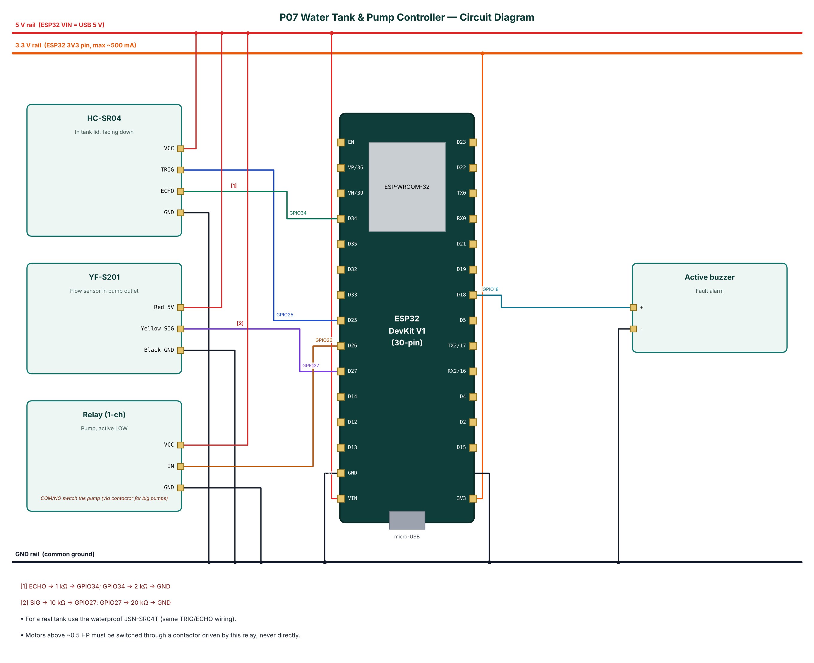

# P07 — Water Tank Level Monitor and Smart Pump Controller

**Cloud:** Adafruit IO · **Level:** Advanced · **Approx. cost:** ₹960 (incl. ESP32, breadboard, cable)

Overhead water tanks in Indian homes either overflow because the motor is left on or run dry because nobody notices. This project measures the water level with an ultrasonic sensor in the tank lid and the actual water flow with a YF-S201 Hall-effect flow sensor, and switches the pump through a relay. In AUTO mode the pump starts below a low threshold and stops at a high threshold. Three protections stop the pump: dry-run (pump on but no flow for 30 s), overflow (level above 98 %) and maximum run time. Level, flow and pump state are published to Adafruit IO, where the dashboard can also switch the pump and change the mode. A phone connected over BLE shows a live tank gauge and allows calibration of the tank dimensions.

📄 Full report: [`reports/P07_Water_Tank_Pump_Controller/P07_Water_Tank_Pump_Controller_Report.pdf`](../reports/P07_Water_Tank_Pump_Controller/P07_Water_Tank_Pump_Controller_Report.pdf) (also `.docx`) — circuit diagram, DFD level 0/1, flowchart, setup steps, test cases, source listing.

## Wiring

| Module | Pin | ESP32 | Note |
|---|---|---|---|
| HC-SR04 | VCC | 5V (VIN) |  |
| HC-SR04 | TRIG | GPIO25 |  |
| HC-SR04 | ECHO | GPIO34 | ECHO -> 1 kΩ -> GPIO34; GPIO34 -> 2 kΩ -> GND |
| HC-SR04 | GND | GND |  |
| YF-S201 | Red 5V | 5V (VIN) |  |
| YF-S201 | Yellow SIG | GPIO27 | SIG -> 10 kΩ -> GPIO27; GPIO27 -> 20 kΩ -> GND |
| YF-S201 | Black GND | GND |  |
| Relay (1-ch) | VCC | 5V (VIN) |  |
| Relay (1-ch) | IN | GPIO26 |  |
| Relay (1-ch) | GND | GND |  |
| Active buzzer | + | GPIO18 |  |
| Active buzzer | - | GND |  |



## Build & flash

* Arduino IDE: board **ESP32 Dev Module**, Partition Scheme **Minimal SPIFFS (1.9MB APP with OTA)**.
* Libraries: NimBLE-Arduino 2.x, ArduinoJson 7.x, PubSubClient.
* Or download `firmware-P07_Water_Tank_Pump_Controller` from GitHub **Actions** and flash `*.merged.bin` at `0x0` with https://espressif.github.io/esptool-js/.

## Configure over BLE

Open **https://rohitkukreja705.github.io/esp32-iot-projects/?p=P07** in Chrome (Android/desktop) → Connect → `IOT-P07-XXXX` → Setup → PIN `1234` → Wi-Fi → cloud keys.

| Setting | Default | Meaning |
|---|---|---|
| `aiouser / aiokey` | — | Adafruit IO credentials |
| `depth` | 100 | Sensor to tank bottom (cm) |
| `fullcm` | 15 | Sensor to full line (cm) |
| `low / high` | 25 / 90 | AUTO thresholds (%) |
| `maxrun` | 30 | Maximum continuous run (min) |

| Command | PIN | Action |
|---|---|---|
| `pump:on / pump:off` | Yes | Manual pump control |
| `mode:auto / mode:manual` | Yes | Select mode |
| `clear` | Yes | Clear fault and silence buzzer |
| `resetvol` | Yes | Reset litres counter |

Example frame:

```json
{"lvl":64,"cm":45.2,"flow":3.12,"lit":12.4,"pump":true,"mode":"AUTO","fault":"","cloud":true,"type":"data"}
```

## Adafruit IO objects

| Object | Content |
|---|---|
| p07-level | Gauge 0-100 % |
| p07-flow | Line chart, L/min |
| p07-pump | Toggle block ON/OFF (remote pump switch) |
| p07-mode | Toggle block AUTO/MANUAL |

## Safety

* The pump is a mains appliance: use a contactor, fuse and proper enclosure; follow electrical codes.
* Seal the electronics against humidity; mount the controller outside the tank.
