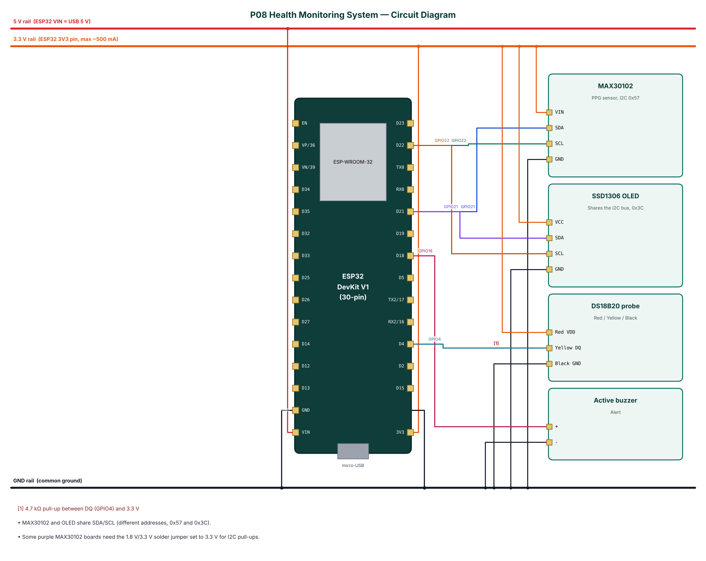

# P08 — IoT Health Monitoring System (Heart Rate, SpO₂, Body Temperature)

**Cloud:** ThingSpeak · **Level:** Advanced · **Approx. cost:** ₹987 (incl. ESP32, breadboard, cable)

This project measures three basic vital signs — heart rate, blood-oxygen saturation (SpO₂) and body temperature — and makes them available locally and remotely. A MAX30102 optical sensor captures red and infrared photoplethysmography (PPG) signals from a fingertip; the ESP32 samples them without blocking at 25 Hz into a sliding four-second window and runs Maxim's reference algorithm every second to estimate heart rate and SpO₂. A waterproof DS18B20 probe measures temperature. Readings appear on an OLED, stream to a phone over BLE and are uploaded to ThingSpeak every 20 seconds while a finger is on the sensor. Configurable limits trigger a buzzer and a phone alert. The system is an educational prototype and not a medical device.

📄 Full report: [`reports/P08_Health_Monitoring_System/P08_Health_Monitoring_System_Report.pdf`](../reports/P08_Health_Monitoring_System/P08_Health_Monitoring_System_Report.pdf) (also `.docx`) — circuit diagram, DFD level 0/1, flowchart, setup steps, test cases, source listing.

## Wiring

| Module | Pin | ESP32 | Note |
|---|---|---|---|
| MAX30102 | VIN | 3V3 |  |
| MAX30102 | SDA | GPIO21 |  |
| MAX30102 | SCL | GPIO22 |  |
| MAX30102 | GND | GND |  |
| SSD1306 OLED | VCC | 3V3 |  |
| SSD1306 OLED | SDA | GPIO21 |  |
| SSD1306 OLED | SCL | GPIO22 |  |
| SSD1306 OLED | GND | GND |  |
| DS18B20 probe | Red VDD | 3V3 |  |
| DS18B20 probe | Yellow DQ | GPIO4 | 4.7 kΩ pull-up between DQ (GPIO4) and 3.3 V |
| DS18B20 probe | Black GND | GND |  |
| Active buzzer | + | GPIO18 |  |
| Active buzzer | - | GND |  |



## Build & flash

* Arduino IDE: board **ESP32 Dev Module**, Partition Scheme **Minimal SPIFFS (1.9MB APP with OTA)**.
* Libraries: NimBLE-Arduino 2.x, ArduinoJson 7.x, PubSubClient, SparkFun MAX3010x Pulse and Proximity Sensor Library, OneWire, DallasTemperature, Adafruit SSD1306, Adafruit GFX Library.
* Or download `firmware-P08_Health_Monitoring_System` from GitHub **Actions** and flash `*.merged.bin` at `0x0` with https://espressif.github.io/esptool-js/.

## Configure over BLE

Open **https://rohitkukreja705.github.io/esp32-iot-projects/?p=P08** in Chrome (Android/desktop) → Connect → `IOT-P08-XXXX` → Setup → PIN `1234` → Wi-Fi → cloud keys.

| Setting | Default | Meaning |
|---|---|---|
| `tskey` | — | ThingSpeak Write API Key |
| `hrlow / hrhigh` | 50 / 120 | Heart-rate limits (bpm) |
| `spo2low` | 92 | SpO₂ lower limit (%) |
| `temphigh` | 38 | Temperature upper limit (°C) |

| Command | PIN | Action |
|---|---|---|
| `status` | No | Device status (the project has no actuator commands) |

Example frame:

```json
{"hr":76,"spo2":98,"temp":36.6,"finger":true,"alert":false,"type":"data"}
```

## ThingSpeak objects

| Object | Content |
|---|---|
| Field 1 | Heart rate (bpm) |
| Field 2 | SpO₂ (%) |
| Field 3 | Temperature (°C) |
| Field 4 | Alert flag (0/1) |
| Status | Alert text or 'normal' |

## Safety

* Educational prototype only — never use it to diagnose, treat or replace professional medical equipment.
* Use a USB power bank or isolated adapter; never connect a person to a device powered from a non-isolated supply.
* Clean the sensor and probe between users.
