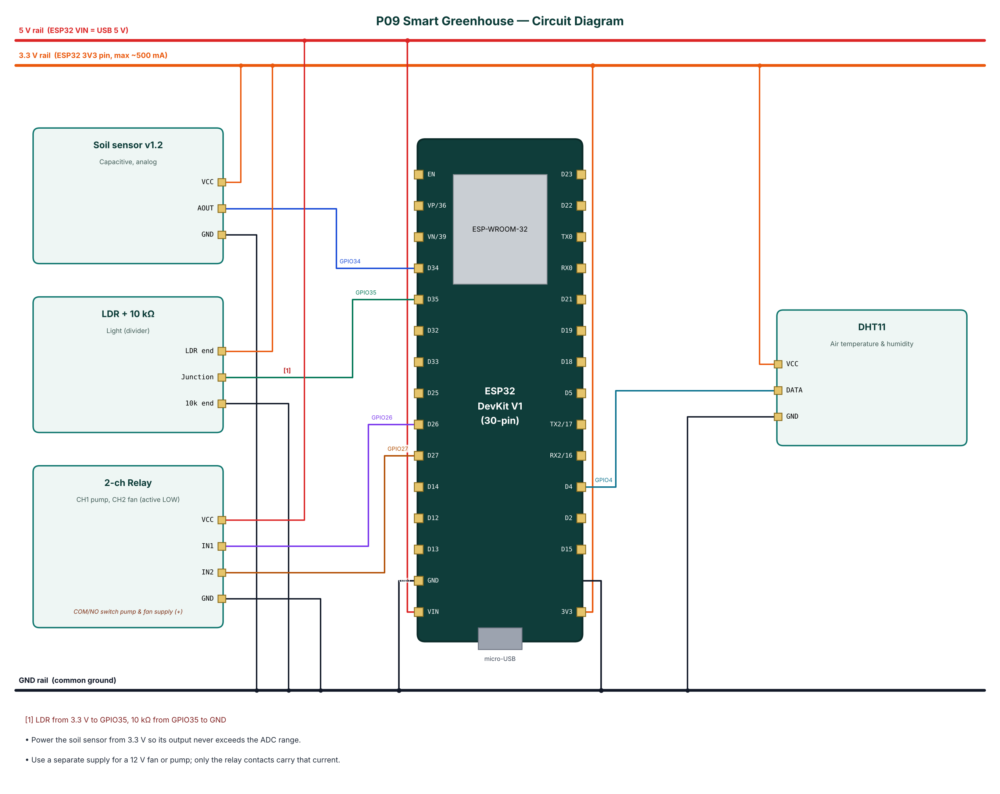

# P09 — Smart Greenhouse with Cloud-Configurable Irrigation

**Cloud:** Supabase · **Level:** Advanced · **Approx. cost:** ₹930 (incl. ESP32, breadboard, cable)

Irrigation by fixed timers wastes water and stresses plants, and greenhouses overheat quickly on sunny days. This project monitors soil moisture with a corrosion-resistant capacitive sensor, air temperature and humidity with a DHT11 and light with an LDR, and controls a water pump and a ventilation fan through a two-channel relay. Irrigation uses a burst-and-soak strategy: the pump runs in short bursts and waits for water to spread before measuring again, which prevents over-watering. The fan runs when temperature or humidity is too high. All readings and actions are logged to Supabase, and the thresholds are read from a settings row in the database, so they can be changed from anywhere in the Supabase table editor. BLE gives local monitoring, manual control and two-point soil calibration.

📄 Full report: [`reports/P09_Smart_Greenhouse/P09_Smart_Greenhouse_Report.pdf`](../reports/P09_Smart_Greenhouse/P09_Smart_Greenhouse_Report.pdf) (also `.docx`) — circuit diagram, DFD level 0/1, flowchart, setup steps, test cases, source listing.

## Wiring

| Module | Pin | ESP32 | Note |
|---|---|---|---|
| Soil sensor v1.2 | VCC | 3V3 |  |
| Soil sensor v1.2 | AOUT | GPIO34 |  |
| Soil sensor v1.2 | GND | GND |  |
| LDR + 10 kΩ | LDR end | 3V3 |  |
| LDR + 10 kΩ | Junction | GPIO35 | LDR from 3.3 V to GPIO35, 10 kΩ from GPIO35 to GND |
| LDR + 10 kΩ | 10k end | GND |  |
| DHT11 | VCC | 3V3 |  |
| DHT11 | DATA | GPIO4 |  |
| DHT11 | GND | GND |  |
| 2-ch Relay | VCC | 5V (VIN) |  |
| 2-ch Relay | IN1 | GPIO26 |  |
| 2-ch Relay | IN2 | GPIO27 |  |
| 2-ch Relay | GND | GND |  |



## Build & flash

* Arduino IDE: board **ESP32 Dev Module**, Partition Scheme **Minimal SPIFFS (1.9MB APP with OTA)**.
* Libraries: NimBLE-Arduino 2.x, ArduinoJson 7.x, PubSubClient, DHT sensor library (Adafruit), Adafruit Unified Sensor.
* Or download `firmware-P09_Smart_Greenhouse` from GitHub **Actions** and flash `*.merged.bin` at `0x0` with https://espressif.github.io/esptool-js/.

## Configure over BLE

Open **https://rohitkukreja705.github.io/esp32-iot-projects/?p=P09** in Chrome (Android/desktop) → Connect → `IOT-P09-XXXX` → Setup → PIN `1234` → Wi-Fi → cloud keys.

| Setting | Default | Meaning |
|---|---|---|
| `sburl / sbkey` | — | Supabase URL and publishable key |
| `soildry / soilwet` | 2800 / 1200 | Soil calibration (mV) |

| Command | PIN | Action |
|---|---|---|
| `mode:auto / mode:manual` | Yes | Select mode (pump turns off on change) |
| `pump:on|off, fan:on|off` | Yes | Manual control (switches to MANUAL) |
| `caldry / calwet` | Yes | Store current soil reading as dry / wet reference |

Example frame:

```json
{"soil":41,"t":31.2,"h":67,"l":82,"pump":false,"fan":true,"mode":"AUTO","state":"soaking","smin":35,"smax":60,"tmax":32,"type":"data"}
```

## Supabase objects

| Object | Content |
|---|---|
| greenhouse_readings | soil, temperature, humidity, light, pump, fan every 60 s |
| greenhouse_events | pump_on/off, fan_on/off with reason |
| greenhouse_settings | Row id=1: soil_min, soil_max, temp_max, hum_max, auto_mode (edit to tune) |

## Safety

* Keep electronics in an IP65 box; route pump and fan wiring with drip loops.
* Use low-voltage pumps/fans where possible; mains pumps need a contactor and RCCB.
