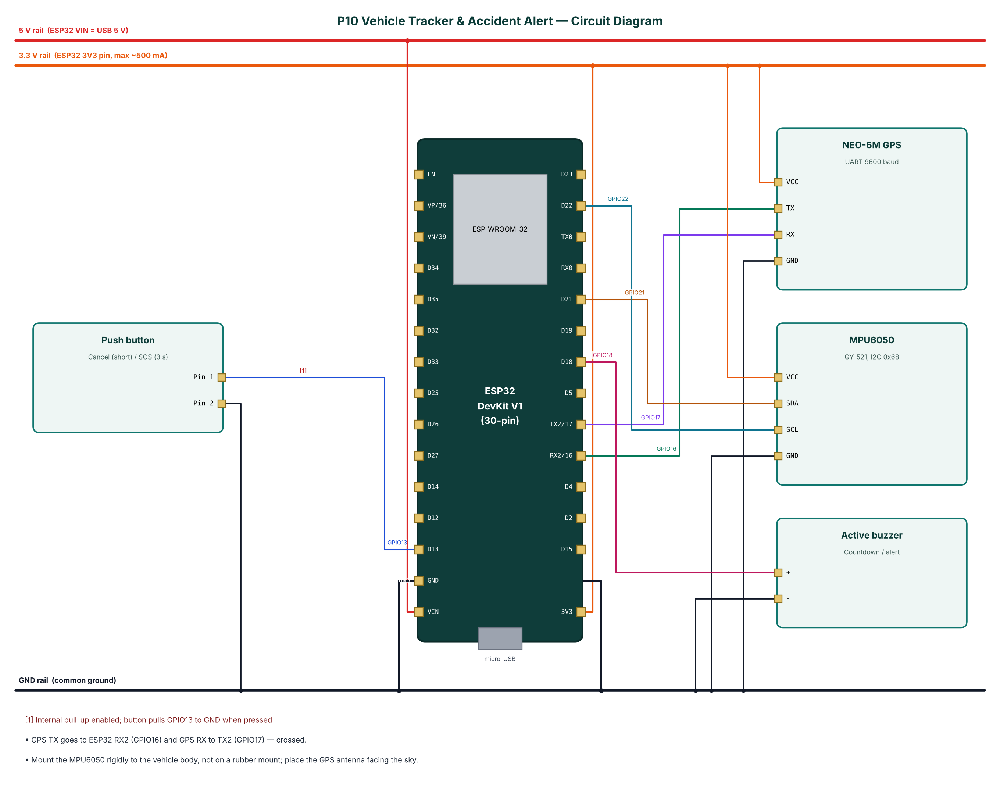

# P10 — Vehicle Tracking and Accident Alert System

**Cloud:** Supabase · **Level:** Advanced · **Approx. cost:** ₹1150 (incl. ESP32, breadboard, cable)

Road accidents in India claim lakhs of lives every year, and delayed help is a major cause. This project tracks a vehicle with a NEO-6M GPS receiver and detects possible accidents with an MPU6050 accelerometer: a sudden impact above a g-force threshold or a rollover (tilt above 60° for 3 seconds) starts a 15-second countdown with a buzzer. If the driver does not cancel with the button, an alert with the GPS location and a Google Maps link is inserted into a Supabase database through the driver's phone hotspot. Holding the button for three seconds sends a manual SOS. The location trail is logged every 30 seconds while moving and every 5 minutes when parked, buffered when offline, and a home geofence raises exit/enter alerts. A phone connected over BLE shows live position, speed and g-force.

📄 Full report: [`reports/P10_Vehicle_Tracker_Accident_Alert/P10_Vehicle_Tracker_Accident_Alert_Report.pdf`](../reports/P10_Vehicle_Tracker_Accident_Alert/P10_Vehicle_Tracker_Accident_Alert_Report.pdf) (also `.docx`) — circuit diagram, DFD level 0/1, flowchart, setup steps, test cases, source listing.

## Wiring

| Module | Pin | ESP32 | Note |
|---|---|---|---|
| NEO-6M GPS | VCC | 3V3 |  |
| NEO-6M GPS | TX | GPIO16 |  |
| NEO-6M GPS | RX | GPIO17 |  |
| NEO-6M GPS | GND | GND |  |
| MPU6050 | VCC | 3V3 |  |
| MPU6050 | SDA | GPIO21 |  |
| MPU6050 | SCL | GPIO22 |  |
| MPU6050 | GND | GND |  |
| Active buzzer | + | GPIO18 |  |
| Active buzzer | - | GND |  |
| Push button | Pin 1 | GPIO13 | Internal pull-up enabled; button pulls GPIO13 to GND when pressed |
| Push button | Pin 2 | GND |  |



## Build & flash

* Arduino IDE: board **ESP32 Dev Module**, Partition Scheme **Minimal SPIFFS (1.9MB APP with OTA)**.
* Libraries: NimBLE-Arduino 2.x, ArduinoJson 7.x, PubSubClient, TinyGPSPlus, Adafruit MPU6050, Adafruit Unified Sensor.
* Or download `firmware-P10_Vehicle_Tracker_Accident_Alert` from GitHub **Actions** and flash `*.merged.bin` at `0x0` with https://espressif.github.io/esptool-js/.

## Configure over BLE

Open **https://rohitkukreja705.github.io/esp32-iot-projects/?p=P10** in Chrome (Android/desktop) → Connect → `IOT-P10-XXXX` → Setup → PIN `1234` → Wi-Fi → cloud keys.

| Setting | Default | Meaning |
|---|---|---|
| `sburl / sbkey` | — | Supabase URL and publishable key |
| `crashg` | 2.5 | Impact threshold (g) |
| `tilt` | 60 | Rollover angle (°) |
| `fence` | — | lat,lng,radius (set by fencehere) |

| Command | PIN | Action |
|---|---|---|
| `reset` | No | Clear an alert state |
| `sos` | No | Send an SOS alert from the phone |
| `fencehere:<metres>` | Yes | Set the home geofence at the current position |

Example frame:

```json
{"fix":true,"lat":23.259933,"lng":77.412613,"spd":34.5,"sat":8,"g":1.07,"pitch":3,"roll":-2,"state":"normal","buf":0,"type":"data"}
```

## Supabase objects

| Object | Content |
|---|---|
| vehicle_locations | lat, lng, speed_kmph, heading, satellites, recorded_at |
| vehicle_alerts | type, detail, g_force, lat, lng, maps_url, speed_kmph |

## Safety

* Do not operate the phone/app while driving.
* Fix the device securely; a loose device can cause false impacts and distract the driver.
* The system supplements, not replaces, calling emergency services (112).
